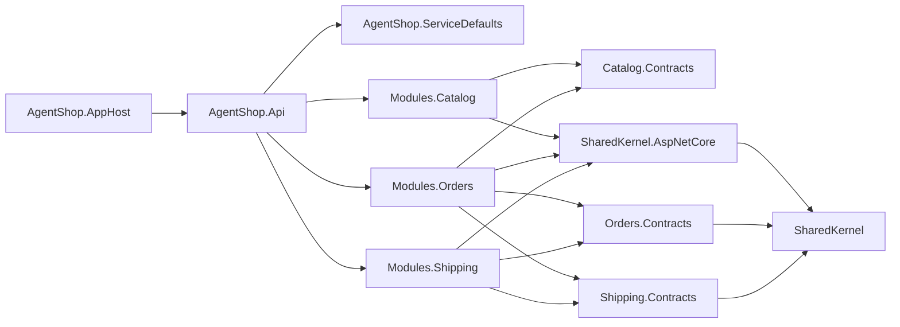
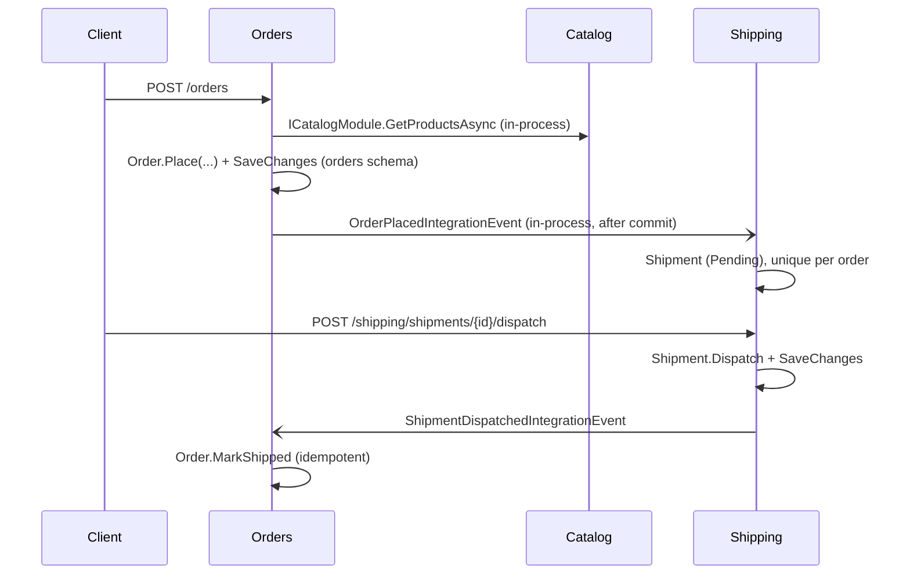

# Architecture

AgentShop is a **modular monolith**: one deployable ASP.NET Core application composed of independent business
modules. Inside each module the code is organized as **vertical slices** (one folder and file per use case).

## Module map

| Module | Owns | Public contract (`*.Contracts`) | Publishes | Consumes |
|---|---|---|---|---|
| Catalog | Products (`catalog` schema) | `ICatalogModule.GetProductsAsync` | – | – |
| Orders | Orders and order lines (`orders` schema) | `OrderPlacedIntegrationEvent` | `OrderPlacedIntegrationEvent` | `ShipmentDispatchedIntegrationEvent` |
| Shipping | Shipments (`shipping` schema) | `ShipmentDispatchedIntegrationEvent` | `ShipmentDispatchedIntegrationEvent` | `OrderPlacedIntegrationEvent` |

## Project dependencies

A module never references another module's internal project. This is enforced by
`tests/AgentShop.ArchitectureTests` and by the naming/reference checks in `Directory.Build.targets`.

## Request and event flow (place order → ship)

## Anatomy of a slice

`Features/<Slice>/<Slice>.cs` contains `Request`, `Response`, `Validator`, a static `HandleAsync` returning `Result`
and a nested `Endpoint`. The golden reference is `Orders/Features/PlaceOrder/PlaceOrder.cs`. See `src/Modules/AGENTS.md`.

## Runtime

- `AgentShop.AppHost` (Aspire) starts PostgreSQL and the API; the API applies module migrations on startup in Development.
- `AgentShop.ServiceDefaults` adds OpenTelemetry, health checks (`/health`, `/alive`), service discovery and resilience.
- OpenAPI document: `/openapi/v1.json`; Scalar UI: `/scalar/v1` (Development only).

## Known limitations (deliberate simplifications)

- **No transactional outbox.** Integration events are published in-process after the commit; if the process dies in
  between, the event is lost, and an exception in a consumer surfaces as a 500 of the publishing request (ADR 0004).
- **Cancelled orders are not propagated to Shipping.** There is no `OrderCancelledIntegrationEvent` handler, so a
  shipment of a cancelled order can still be dispatched; Orders then refuses to mark it shipped and logs a warning.
- **No authentication/authorization**, no pagination beyond the catalog list, single currency (CZK).
- **Migrations run on startup in Development only**; production needs a separate migration step (ADR 0005).
